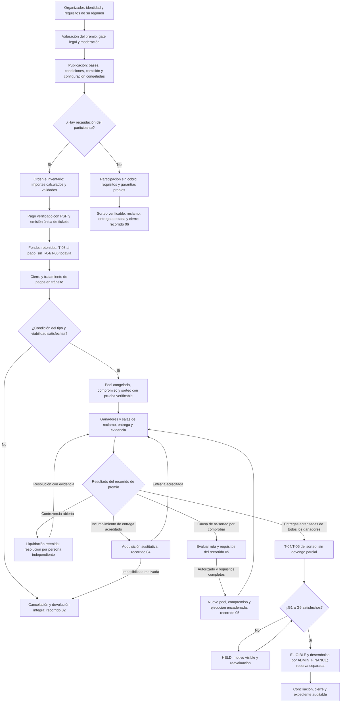

# Flujo end-to-end de Libox

**ACT-P08 · Revisión documental del 18/10/2026.** Diego confirmó que el diagrama
del repositorio era el único disponible y pidió crear uno actual. Esta guía de
trabajo sustituye el diagrama del 19/06/2026 y concilia rev6 con las decisiones
aprobadas de Diego. El paquete rev6 conserva su aceptación/emisión pendiente.
El estado `vigente` identifica esta guía de trabajo; no emite el canon ni acredita
implementación. Los pasos del mapa orientan la lectura, no constituyen una nueva FSM.

## Mapa general

El re-sorteo genera una ejecución nueva y encadenada; nunca reejecuta ni edita el
sorteo original. Los recorridos detallan los rechazos que el mapa resume.

## Recorridos y evidencias

| ID | Recorrido | Documento | Prueba pendiente |
|---|---|---|---|
| 01 | Compra aprobada, duplicados y pagos tardíos | [Financiero](recorridos-financieros-rev6.md#01-compra-y-confirmación-de-pago) | E2E-P08-01 |
| 02 | Condición no alcanzada y devolución | [Financiero](recorridos-financieros-rev6.md#02-cancelación-y-devolución) | E2E-P08-02 |
| 03 | Entrega, devengo, gates, reserva y liquidación | [Financiero](recorridos-financieros-rev6.md#03-entrega-y-liquidación) | E2E-P08-03 |
| 04 | Incumplimiento y adquisición sustitutiva | [Premios](recorridos-premios-rev6.md#04-adquisición-sustitutiva) | E2E-P08-04 |
| 05 | Re-sorteo permitido o rechazado | [Premios](recorridos-premios-rev6.md#05-re-sorteo) | E2E-P08-05 |
| 06 | Participación sin recaudación y régimen promocional | [Premios](recorridos-premios-rev6.md#06-sin-recaudación-del-participante) | E2E-P08-06 |

La [matriz de Desarrollo](../desarrollo/pruebas-pendientes-rev6.md#act-p08-pruebas-del-flujo-completo)
conserva resultados esperados y todos los casos **PENDIENTES**.

## Seis compuertas del régimen con recaudación

| Gate | Condición para liquidar |
|---|---|
| G1 | Sorteo ejecutado con prueba válida y verificable. |
| G2 | Entrega acreditada vigente por cada ganador, por rol competente. |
| G3 | Cero controversias abiertas sobre el sorteo. |
| G4 | Ventana desde el último pago aprobado vencida y sin contracargos abiertos. |
| G5 | Datos de cobro verificados y a nombre del titular del KYB. |
| G6 | Ledger cuadrado y sin excepciones de conciliación abiertas. |

La evaluación es automática y determinista. Elegibilidad no equivale a pago:
`ADMIN_FINANCE` ejecuta el desembolso. La reserva RN-104 y su liberación T-09
tienen un control propio: atestación más ventana extendida, separado de G4.

## Arquitectura y separación de funciones

- Frontend: **Next.js 16 + TypeScript + Turbopack**, por ACT-R6-07. Parche exacto,
  actualización de dependencias y validación del despliegue siguen pendientes.
- API y worker: **Go**, con módulos de negocio compartidos; PostgreSQL en Supabase.
  El [OS IA](../equipo/sistema-operativo-ia.md) conserva los acuerdos de alojamiento.
- Soporte recoge evidencia y el rol competente acredita la entrega según categoría.
  `ADMIN_LEGAL_COMPLIANCE` resuelve controversias; firmantes y cofirmantes de
  valoración/entrega no adjudican en ninguna sala del mismo sorteo, ni al revés.
- Ajustes T-14: motivo, ejecutor `ADMIN_FINANCE` y segunda autorización de
  `ADMIN_SUPER`, personas naturales y subroles distintos; ACT-R6-10.
- Auditoría transversal: actor/persona, objeto, evidencia, sello de servidor y traza.
  Un archivo con hash no demuestra por sí solo que la entrega ocurrió.

El [delivery aprobado](delivery-premios-rev6.md), ACT-R6-14, define recorrido,
modalidades, transición para servicios/registrables y segunda firma registrable.
Conserva evidencia, consentimiento y separación de firmantes/adjudicadores.
Diseño visual y desarrollo siguen pendientes; ACT-P08 mantiene su cierre documental.

## Pendientes que este flujo deja visibles

| Acción | Límite o dependencia actual |
|---|---|
| ACT-R6-01/02/03/04 | Aceptación/emisión de rev6, dictamen legal, admisión comercial del PSP y titularidad/facultades sobre fondos. |
| ACT-P04 | Diego confirmó ausencia de integración de pagos y cuenta de pruebas. |
| ACT-P06 | Diego confirmó que aún no recibió el paquete de arte maestro y branding. |
| ACT-R6-08 | Prioridad económica aprobada; cuentas, compensación/reversión T-05 y asiento T-19 por validar. |
| ACT-R6-09/10/11/12/14 | Controles aprobados con implementación, parámetros y subcasos abiertos; no se atribuye cobertura completa. |
| ACT-R6-13/15/16/17 | Plan por hueco, controles del servicio, pruebas/artefactos y presupuesto/capacidad por completar. |

La titularidad de fondos y los requisitos legales se cierran en sus acciones;
este diagrama no fija custodio ni sustituye el dictamen `[LEGAL→ABOGADO]`.
El [freeze del scaffold](../../.claude/rules/src-congelado.md) y las
[zonas sin generación asistida](../../.claude/rules/zonas-sin-ia.md) siguen aplicando.

## Fuentes de reconciliación

- [PRD V22](https://liboxapp.getoutline.com/doc/libox-prd-blueprint-mvp-v22-wp9CiWihnf): §§4–5, 10–16; FSM, regímenes, pagos, entrega y liquidación.
- [L3 V21](https://liboxapp.getoutline.com/doc/libox-especificacion-tecnica-l3-v21-yC2vKLLNbN): datos, transacciones y controles técnicos.
- [Registro V24](https://liboxapp.getoutline.com/doc/libox-registro-maestro-de-linea-base-v24-TBDcjlR1hE): H21/H22 y límites de cobertura.
- [Decisiones de Diego](https://liboxapp.getoutline.com/doc/diego-pendientes-y-decisiones-tecnicas-rev6-dET6AASY9e): ACT-R6-07/08/09/10/11/12/14 y ACT-P05 aprobados; ACT-P04/P06 confirmados.
- [Tablero de acciones](https://liboxapp.getoutline.com/doc/21-tablero-de-acciones-tasks-iCoCY5qOjR): responsables, dependencias y cierres.
