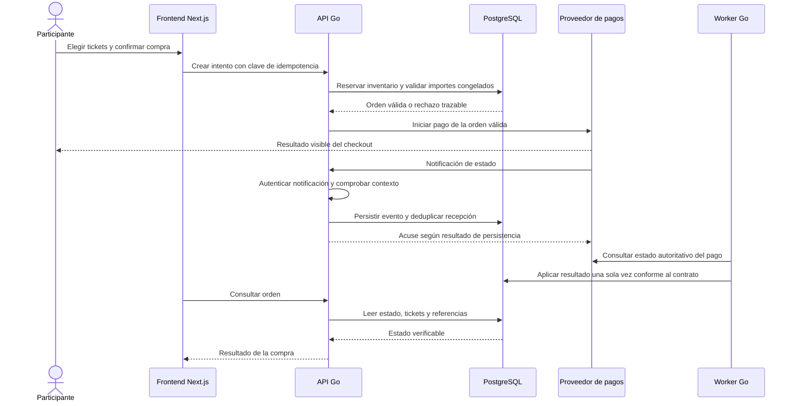
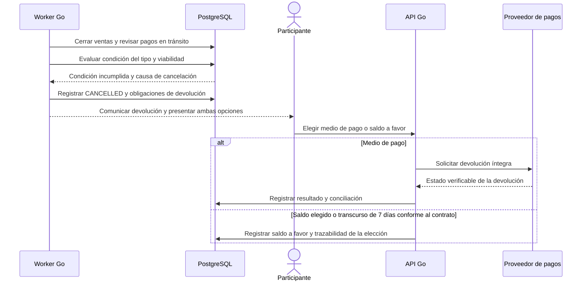
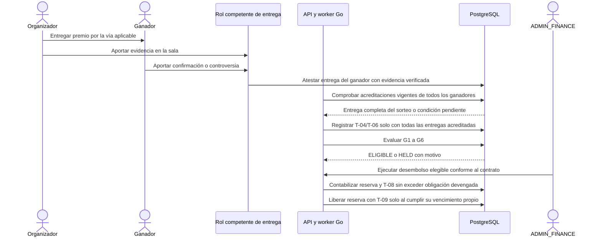

# Recorridos financieros rev6

Detalle de trabajo del [mapa general](flujo-end-to-end.md); no acredita servicios
implementados ni emite el canon. Son responsabilidades lógicas, no una elección
nueva de endpoints, colas, aislamiento o fronteras transaccionales.

## 01 Compra y confirmación de pago

Un redirect o mensaje del navegador no confirma el pago. El servidor contrasta
orden, cuenta receptora, moneda e importe; una notificación no autenticada se rechaza.
Un evento válido duplicado no duplica tickets ni asientos. Eventos fuera de orden
no retroceden estados; las excepciones se conservan con alarma y recuperación.
Ventanas anti-repetición y variantes reales del PSP requieren validación.

**Efectos:** al confirmar pago, tickets e importe corresponden a la orden y T-05
devenga el neto del organizador en la misma transacción de confirmación.
La recaudación continúa retenida: no hay split inmediato ni T-04/T-06 al pagar.
El desglose deriva de la configuración congelada; discordancia de comisión o neto
se rechaza según ACT-R6-10, sin alterar silenciosamente los valores.

**Reservas y pagos tardíos:** la reserva de inventario tiene vencimiento configurado.
Vencida la reserva, se emiten tickets solo si hay inventario y la venta admite
la operación. Sin inventario, con venta cerrada o pool congelado, corresponde el
reembolso íntegro de RN-65-sexies; no se agrega un ticket al pool congelado.
LIBOX asume costes de cobro/devolución de esos pagos tardíos. La firma, deduplicación
y consulta autenticada no sustituyen la ejecución patrimonial única.

**Prueba E2E-P08-01:** aprobado, rechazado, pendiente, duplicado, fuera de orden y
confirmación tardía; conservar orden, evento, tickets, T-05 y traza. Pendiente.

## 02 Cancelación y devolución

Antes de evaluar viabilidad al cierre se aplica la espera de RN-65-septies:
el menor entre el vencimiento de la última reserva viva y seis horas desde el cierre.
Los pagos aún sin confirmar al vencer esa espera siguen RN-65-sexies/octies.
Los disparadores dependen del tipo; no se reemplazan todos por un mismo umbral.

En cancelación, devolución del **100% pagado**. Medio de pago y saldo a favor
se muestran con igual visibilidad y facilidad. Si no se elige en siete días, se
aplica saldo después de presentar la elección; no es abono silencioso.
Rige RN-106-bis y la derogación de RN-64, incluso en escenarios antiguos que decían saldo automático.
El saldo no admite recargas voluntarias y tiene pasivo y trazabilidad propios.
Los asientos de devolución/reversión conservan sus referencias; este recorrido
no inventa cuentas o reversiones fuera del catálogo transaccional.

**Prueba E2E-P08-02:** cancelación válida, ambas rutas, vencimiento, devolución
íntegra, costes a cargo de LIBOX y ausencia de doble devolución. Pendiente.

## 03 Entrega y liquidación

Con entrega parcial de un sorteo multi-ganador no se registra comisión parcial
ni se cumple G2. Las acreditaciones nombran al ganador y deben estar vigentes.
T-04/T-06 son devengo, no desembolso; T-08 paga una obligación ya devengada.
El [delivery operativo](delivery-premios-rev6.md) debe detallarse con el criterio
de evidencia aprobado en ACT-R6-14; el mapa general no sustituye sus pantallas.
G4 cuenta desde el **último pago aprobado** y exige ausencia de contracargos abiertos.
La reserva RN-104 vence desde la **atestación más la ventana extendida**. Con un plazo
faltante se usa el mayor aplicable de un catálogo vigente validado con el PSP; sin
plazo comprobable se bloquea la liberación y se abre incidencia, según ACT-R6-11.
Un contracargo genera T-13 y alarma, cierra G4 y no altera tickets del pool congelado.
Una controversia abierta impide liquidar; expediente y resolución son trazables.

**Prueba E2E-P08-03:** entregas parciales/completas/revertidas, gates, controversia,
contracargo, plazo faltante y T-09 prematura. Pendiente de ejecución.

Fuentes: [PRD V22](https://liboxapp.getoutline.com/doc/libox-prd-blueprint-mvp-v22-wp9CiWihnf)
§§10–16; [L3 V21](https://liboxapp.getoutline.com/doc/libox-especificacion-tecnica-l3-v21-yC2vKLLNbN);
[decisiones de Diego](https://liboxapp.getoutline.com/doc/diego-pendientes-y-decisiones-tecnicas-rev6-dET6AASY9e)
ACT-R6-09/10/11. [Casos pendientes](../desarrollo/pruebas-pendientes-rev6.md#act-p08-pruebas-del-flujo-completo).
