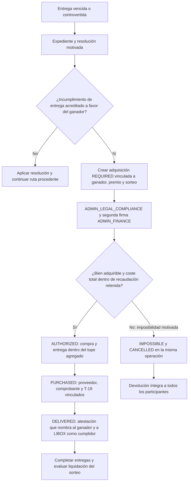
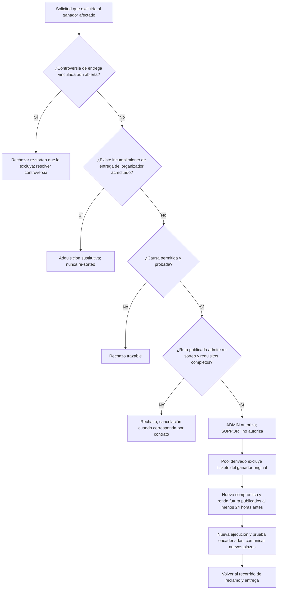
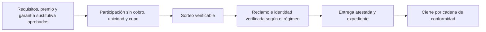

# Recorridos de premios rev6

Detalle de trabajo del [mapa general](flujo-end-to-end.md). Describe comportamientos
del contrato y decisiones aprobadas; no acredita su implementación.

## 04 Adquisición sustitutiva

La adjudicación favorable por entrega crea la obligación de adquisición en la misma
operación. Se paga al proveedor del bien; el efectivo al ganador no es alternativa
estándar. Las firmas corresponden a personas distintas con competencia vigente.
Costes de compra y entrega se suman para todas las adquisiciones del sorteo y
no pueden exceder su recaudación retenida.

**ACT-R6-08:** cubrir compra y entrega primero; conservar la comisión publicada hasta
donde alcance el saldo; renunciar a la parte necesaria y dejar el sobrante al organizador.
ACT-R6-09 conserva el devengo después de acreditar todas las entregas.
**H22-01 sigue abierto:** cuenta afectada, compensación/reclasificación, posible reversión
de T-05 y detalles de T-19 requieren validación contable antes de implementar esta ruta.
No se deciden esos asientos ni se equiparan recaudación bruta y saldo disponible.

El incumplimiento del organizador **nunca es causa de re-sorteo**. La cancelación por
imposibilidad debe ser motivada y simultánea; no deja al ganador en espera indefinida.

**Prueba E2E-P08-04:** obligación creada, firmas competentes distintas, proveedor/T-19,
tope agregado y entrega vinculada; imposibilidad con cancelación/devolución. Pendiente,
con fixtures y asientos sujetos al cierre contable de H22-01.

## 05 Re-sorteo

Las cuatro causas son: `WINNER_NO_CLAIM` con vencimiento/contacto agotado acreditados;
`SHIPPING_ABANDONED` con su estado y plazo; `WINNER_DECLINED` con renuncia firmada;
`WINNER_INELIGIBLE` con expediente resuelto como rechazado. La [matriz ACT-R6-12](../desarrollo/r612-resorteo-estados-permisos.md), aprobada el
18/10/2026, añade Renuncia validada e Inelegibilidad confirmada desde sala no terminal
y antes de entrega acreditada. Autoriza exclusivamente ADMIN_LEGAL_COMPLIANCE con
permiso explícito. Antes de ejecutar se comprueban de nuevo los bloqueos; una
controversia pertinente posterior a autorizar pausa la ejecución. Incorporación a
L3, implementación y pruebas siguen pendientes.

La ruta se declara al crear, se publica y no se cambia después. En categorías
registrables es cancelación obligatoria. Se permite **como máximo un re-sorteo**;
el segundo fallo lleva a cancelación y devolución íntegra. Rechazar una solicitud
no cancela automáticamente salvo que el contrato indique esa salida.
Descartar una controversia no autoriza automáticamente el re-sorteo: se vuelven a
comprobar todos los requisitos. El bloqueo de ACT-R6-12 protege al ganador afectado;
no inventa un bloqueo general de otros ganadores.
ACT-R6-14 separa a adjudicadores de firmantes y cofirmantes de valoración/entrega,
por persona, en todas las salas del sorteo y en ambos órdenes de intervención.

**Prueba E2E-P08-05:** cuatro causas probadas/no probadas, ruta, registrables, límite
de un re-sorteo, compromiso, permisos y controversia abierta; incluir rutas por
DISPUTED. Pendiente; H22-03/H22-11 no se declaran cerrados.

## 06 Sin recaudación del participante

T7 conserva una participación por persona, igualdad de probabilidad, cupo atómico y
verificación de identidad diferida al reclamo. El tipo de sorteo y el régimen del
organizador son ejes distintos: T7 no es sinónimo de régimen promocional.
En el régimen promocional se cobra el plan por adelantado; no hay recaudación del
participante ni liquidación marketplace. La cadena es valoración aprobada, sorteo
ejecutado, entrega atestada y cierre; G4, G5 y G6 no aplican.
El incumplimiento sigue las garantías sustitutivas del régimen y su expediente,
sin inventar recaudación retenida inexistente para financiar la adquisición.

**Prueba E2E-P08-06:** habilitación/garantía, cupo/unicidad, verificación diferida
donde corresponda y cierre con entrega; sin crear liquidación marketplace. Pendiente.

Fuentes: [PRD V22](https://liboxapp.getoutline.com/doc/libox-prd-blueprint-mvp-v22-wp9CiWihnf)
§§5.5–5.6, 13–16; [L3 V21](https://liboxapp.getoutline.com/doc/libox-especificacion-tecnica-l3-v21-yC2vKLLNbN);
[decisiones de Diego](https://liboxapp.getoutline.com/doc/diego-pendientes-y-decisiones-tecnicas-rev6-dET6AASY9e)
ACT-R6-08/09/12/14. [Casos pendientes](../desarrollo/pruebas-pendientes-rev6.md#act-p08-pruebas-del-flujo-completo).
